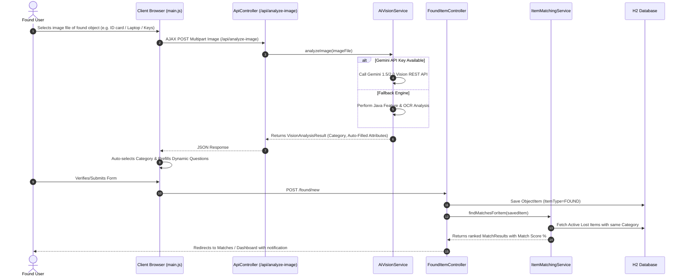
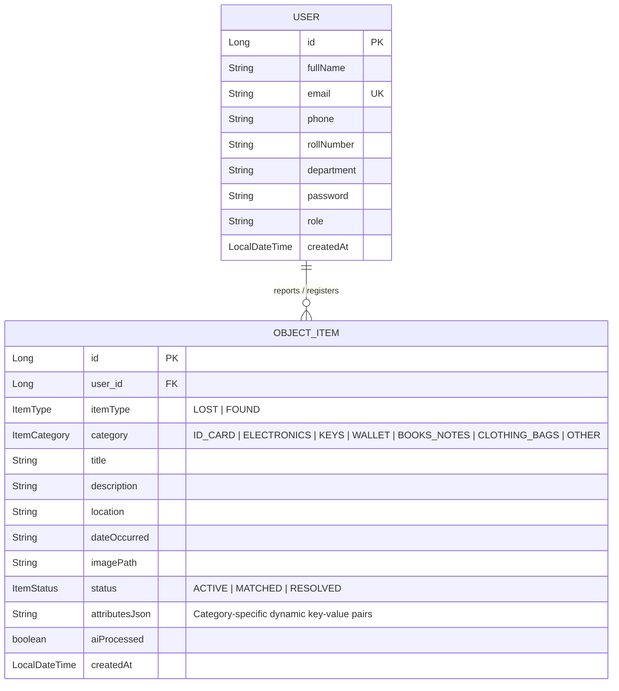

# Campus Lost & Found Platform - Technical Architecture & File Directory Report

## 1. System Architecture Overview

The **Campus Lost & Found Platform** is a full-stack Java web application designed with Spring Boot 3.2, Spring Security, Spring Data JPA, Thymeleaf, and AI-powered Image Recognition.

```mermaid
graph TD
    User([Campus Student / Staff User])
    
    subgraph Frontend Layer [Thymeleaf + HTML5 + Tailwind CSS + JS]
        AuthViews[Login & Registration Views]
        DashView[User Dashboard & Feed]
        FoundView[Found Item Form + AI Upload]
        LostView[Lost Item Form + Dynamic Questions]
        MatchView[Match Connections & Contact View]
    end

    subgraph Spring Security & Controller Layer
        SecConfig[Spring Security Filter Chain & BCrypt]
        AuthCtrl[AuthController]
        DashCtrl[DashboardController]
        FoundCtrl[FoundItemController]
        LostCtrl[LostItemController]
        MatchCtrl[MatchController]
        ApiCtrl[ApiController AJAX Endpoint]
    end

    subgraph Service & AI Layer
        UserSvc[UserService]
        StoreSvc[StorageService Local Uploads]
        AiSvc[AiVisionService Gemini API + Java Vision Engine]
        MatchSvc[ItemMatchingService Fuzzy Matrix]
    end

    subgraph Persistence Layer [Spring Data JPA + H2 Engine]
        UserRepo[UserRepository]
        ItemRepo[ObjectItemRepository]
        H2Db[(H2 Persistent File DB ./data/campus_db)]
    end

    User -->|HTTP GET/POST| Frontend Layer
    Frontend Layer -->|Form Submit / AJAX| SecConfig
    SecConfig --> AuthCtrl & DashCtrl & FoundCtrl & LostCtrl & MatchCtrl & ApiCtrl

    FoundView -->|AJAX /api/analyze-image| ApiCtrl
    ApiCtrl -->|Image Multipart| AiSvc

    FoundCtrl --> StoreSvc
    FoundCtrl --> MatchSvc
    LostCtrl --> MatchSvc

    UserSvc --> UserRepo
    MatchSvc --> ItemRepo
    UserRepo & ItemRepo --> H2Db
```

---

## 2. Found Item Module with AI Recognition Flow



---

## 3. Database Schema Diagram (ERD)



---

## 4. Comprehensive File Report & Codebase Index

Below is the complete inventory of all project files created in `c:\Users\Goutham\Campus_Lost_Find_Platform`:

### Build & Configuration Files
- **[pom.xml](file:///c:/Users/Goutham/Campus_Lost_Find_Platform/pom.xml)**: Maven project build configuration containing Spring Boot 3.2 dependencies for Web, Security, Data JPA, Thymeleaf, and H2 database.
- **[application.properties](file:///c:/Users/Goutham/Campus_Lost_Find_Platform/src/main/resources/application.properties)**: Configures application settings, H2 file database connection (`jdbc:h2:file:./data/campus_db`), upload directory, and optional Gemini API key.

### Main Java Application & Security
- **[CampusLostFoundApplication.java](file:///c:/Users/Goutham/Campus_Lost_Find_Platform/src/main/java/com/campus/lostfound/CampusLostFoundApplication.java)**: Main entry point for the Spring Boot web application.
- **[SecurityConfig.java](file:///c:/Users/Goutham/Campus_Lost_Find_Platform/src/main/java/com/campus/lostfound/config/SecurityConfig.java)**: Spring Security configuration setting up password encoding (BCrypt), URL authorization rules, session management, and H2 console frame options.

### Domain Models & DTOs
- **[User.java](file:///c:/Users/Goutham/Campus_Lost_Find_Platform/src/main/java/com/campus/lostfound/model/User.java)**: JPA entity representing campus users (students and staff) with contact details, roll number, and department.
- **[ObjectItem.java](file:///c:/Users/Goutham/Campus_Lost_Find_Platform/src/main/java/com/campus/lostfound/model/ObjectItem.java)**: JPA entity storing lost and found items, their status, image path, and JSON-serialized category attributes.
- **[ItemType.java](file:///c:/Users/Goutham/Campus_Lost_Find_Platform/src/main/java/com/campus/lostfound/model/ItemType.java)**: Enum distinguishing `LOST` vs `FOUND` items.
- **[ItemCategory.java](file:///c:/Users/Goutham/Campus_Lost_Find_Platform/src/main/java/com/campus/lostfound/model/ItemCategory.java)**: Enum defining standardized campus categories (`ID_CARD`, `ELECTRONICS`, `KEYS`, `WALLET`, `BOOKS_NOTES`, `CLOTHING_BAGS`, `OTHER`).
- **[ItemStatus.java](file:///c:/Users/Goutham/Campus_Lost_Find_Platform/src/main/java/com/campus/lostfound/model/ItemStatus.java)**: Enum representing item lifecycle states (`ACTIVE`, `MATCHED`, `RESOLVED`).
- **[MatchResult.java](file:///c:/Users/Goutham/Campus_Lost_Find_Platform/src/main/java/com/campus/lostfound/model/MatchResult.java)**: Data structure holding paired Lost and Found items, calculated match confidence percentage, and matching rationale.
- **[UserRegistrationDto.java](file:///c:/Users/Goutham/Campus_Lost_Find_Platform/src/main/java/com/campus/lostfound/dto/UserRegistrationDto.java)**: Data transfer object for user account creation forms.
- **[ItemUploadForm.java](file:///c:/Users/Goutham/Campus_Lost_Find_Platform/src/main/java/com/campus/lostfound/dto/ItemUploadForm.java)**: Data transfer object capturing uploaded images and category-specific dynamic question inputs.
- **[VisionAnalysisResult.java](file:///c:/Users/Goutham/Campus_Lost_Find_Platform/src/main/java/com/campus/lostfound/dto/VisionAnalysisResult.java)**: Data transfer object returning AI image classification and auto-filled attributes to the frontend.

### Persistence Repositories
- **[UserRepository.java](file:///c:/Users/Goutham/Campus_Lost_Find_Platform/src/main/java/com/campus/lostfound/repository/UserRepository.java)**: Spring Data JPA repository for user CRUD operations and email uniqueness checks.
- **[ObjectItemRepository.java](file:///c:/Users/Goutham/Campus_Lost_Find_Platform/src/main/java/com/campus/lostfound/repository/ObjectItemRepository.java)**: Spring Data JPA repository for querying lost and found items by category, user, type, and active status.

### Business & AI Services
- **[UserService.java](file:///c:/Users/Goutham/Campus_Lost_Find_Platform/src/main/java/com/campus/lostfound/service/UserService.java)**: Handles user account creation, password hashing, and user authentication lookups.
- **[StorageService.java](file:///c:/Users/Goutham/Campus_Lost_Find_Platform/src/main/java/com/campus/lostfound/service/StorageService.java)**: Handles secure local storage and retrieval of uploaded item photos.
- **[AiVisionService.java](file:///c:/Users/Goutham/Campus_Lost_Find_Platform/src/main/java/com/campus/lostfound/service/AiVisionService.java)**: AI engine calling Gemini Vision API or falling back to Java Feature Vision Analysis to detect item categories and pre-fill dynamic questions.
- **[ItemMatchingService.java](file:///c:/Users/Goutham/Campus_Lost_Find_Platform/src/main/java/com/campus/lostfound/service/ItemMatchingService.java)**: Intelligent fuzzy matching engine comparing lost vs found attributes and calculating match confidence percentages.

### Web Controllers & REST APIs
- **[AuthController.java](file:///c:/Users/Goutham/Campus_Lost_Find_Platform/src/main/java/com/campus/lostfound/controller/AuthController.java)**: Handles `/login` and `/register` HTTP requests.
- **[DashboardController.java](file:///c:/Users/Goutham/Campus_Lost_Find_Platform/src/main/java/com/campus/lostfound/controller/DashboardController.java)**: Renders the user home dashboard, displaying active user items, recent campus activity, and match alerts.
- **[FoundItemController.java](file:///c:/Users/Goutham/Campus_Lost_Find_Platform/src/main/java/com/campus/lostfound/controller/FoundItemController.java)**: Manages found item submission and integrates with AI vision auto-filling.
- **[LostItemController.java](file:///c:/Users/Goutham/Campus_Lost_Find_Platform/src/main/java/com/campus/lostfound/controller/LostItemController.java)**: Manages lost item reports using dynamic question fields and initiates automated matching.
- **[MatchController.java](file:///c:/Users/Goutham/Campus_Lost_Find_Platform/src/main/java/com/campus/lostfound/controller/MatchController.java)**: Displays matched item pairs, match confidence scores, and manages user connection contact exchanges.
- **[ApiController.java](file:///c:/Users/Goutham/Campus_Lost_Find_Platform/src/main/java/com/campus/lostfound/controller/ApiController.java)**: REST controller handling AJAX requests for AI image recognition (`/api/analyze-image`).

### Static Assets & Frontend UI Templates
- **[styles.css](file:///c:/Users/Goutham/Campus_Lost_Find_Platform/src/main/resources/static/css/styles.css)**: Custom CSS containing glassmorphic card styling, gradient banners, and AI pulse animation keyframes.
- **[main.js](file:///c:/Users/Goutham/Campus_Lost_Find_Platform/src/main/resources/static/js/main.js)**: Client-side JavaScript rendering dynamic category question schemas and handling asynchronous AI image recognition upload.
- **[navbar.html](file:///c:/Users/Goutham/Campus_Lost_Find_Platform/src/main/resources/templates/fragments/navbar.html)**: Reusable header navigation bar fragment.
- **[login.html](file:///c:/Users/Goutham/Campus_Lost_Find_Platform/src/main/resources/templates/login.html)**: User authentication login page.
- **[register.html](file:///c:/Users/Goutham/Campus_Lost_Find_Platform/src/main/resources/templates/register.html)**: Student and staff account registration form.
- **[dashboard.html](file:///c:/Users/Goutham/Campus_Lost_Find_Platform/src/main/resources/templates/dashboard.html)**: Interactive user dashboard showing personal listings and match alerts.
- **[found_form.html](file:///c:/Users/Goutham/Campus_Lost_Find_Platform/src/main/resources/templates/found_form.html)**: Found module form with AI image recognition and auto-filled questions.
- **[lost_form.html](file:///c:/Users/Goutham/Campus_Lost_Find_Platform/src/main/resources/templates/lost_form.html)**: Lost module form with category-specific questionnaires.
- **[matches.html](file:///c:/Users/Goutham/Campus_Lost_Find_Platform/src/main/resources/templates/matches.html)**: Match results page presenting side-by-side comparisons and user contact details.
